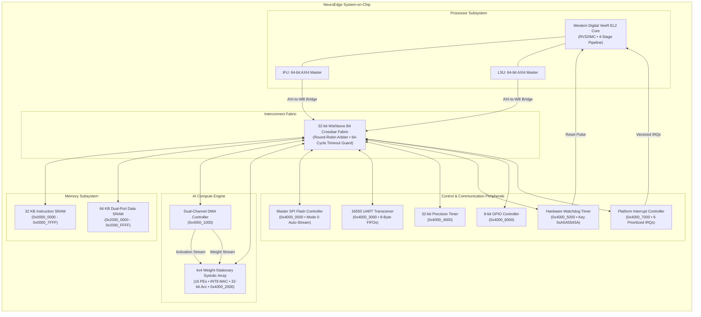

# NeuroEdge: RISC-V SoC with Systolic-Array AI Acceleration

[-brightgreen.svg)]()
[]()
[-blue.svg)]()
[]()

**NeuroEdge** is an edge-computing 32-bit RISC-V System-on-Chip (SoC) engineered for low-power, deterministic neural-network inference. It integrates an industry-grade **Western Digital VeeR EL2 (RV32IMC)** 4-stage pipeline processor with a high-throughput **4×4 Weight-Stationary Systolic Array Accelerator**, an autonomous **Dual-Channel DMA**, a **Master SPI Flash Controller**, a **16550 UART Transceiver**, precision timers, a safety **Watchdog Timer (WDT)**, general-purpose I/O (**GPIO**), and a **Platform Interrupt Controller (PIC)** communicating across a 32-bit pipelined **Wishbone B4 Crossbar Interconnect**.

---

## 🏛️ System Architecture



---

## 🗺️ Memory Map

| Base Address | Size | Subsystem / Register Space | Description |
| :--- | :--- | :--- | :--- |
| `0x0000_0000` | 32 KB | **Instruction SRAM (ISRAM)** | Firmware boot code, interrupt service routines, reset vector (`0x0000_0000`). |
| `0x2000_0000` | 32 KB | **Data SRAM Bank 0 (DSRAM0)** | Core stack, global variables, heap storage. |
| `0x2000_8000` | 8 KB | **Data SRAM Weight Buffer** | Staging buffer for quantized INT8 weights transferred from SPI Flash. |
| `0x2000_A000` | 4 KB | **Data SRAM Activation Buffer**| Staging buffer for incoming INT8 input activations. |
| `0x2000_B000` | 20 KB | **Data SRAM Output Buffer** | Post-processed classification and output probability distribution. |
| `0x4000_0000` | 32 B | **SPI Flash Controller** | Master SPI interface registers for non-volatile Flash parameter retrieval. |
| `0x4000_1000` | 48 B | **Dual-Channel DMA** | Channel 0 (activations) and Channel 1 (weights) configuration registers. |
| `0x4000_2000` | 64 B | **Systolic Array Accelerator** | Status, Control, Preload, and Column Result registers (`RES_REG[3:0]`). |
| `0x4000_3000` | 32 B | **16550 UART Transceiver** | Data TX/RX FIFOs, baud divisor registers, interrupt enables, status. |
| `0x4000_4000` | 32 B | **32-bit Precision Timer** | Counter value and match comparator threshold registers. |
| `0x4000_5000` | 32 B | **Hardware Watchdog Timer**| Heartbeat reload register (`0xA5A5_5A5A`), countdown timer, bark IRQ. |
| `0x4000_6000` | 16 B | **8-bit GPIO Controller** | Direction configuration, input pin sampling, output pin drive. |
| `0x4000_7000` | 32 B | **Platform Interrupt Controller**| Pending, enable, priority, and acknowledge registers for 6 IRQ sources. |

---

## 🚀 Quickstart: Running Simulations on Linux Workstation

Ensure your Synopsys EDA environment is loaded:
```bash
module load vcs
module load verdi
# Or source your workstation's Synopsys license script:
# source /tools/synopsys/env.sh
```

---

### Option A: Master UVM 1.2 Verification Regression (Recommended)
To compile and execute the complete **16-run multi-seed UVM regression suite**, generate functional/code coverage reports, and perform FSDB sanity checks:
```bash
bash verification/scripts/run_all_uvm_tests.sh
```

#### Multi-Seed Regression Matrix (100% Passed)
| Test Name | Seeds | Plusargs | Description & Checks |
| :--- | :--- | :--- | :--- |
| `neuroedge_systolic_test` | `1, 42, 12345` | `+CPU_OVERRIDE=1` | 4×4 INT8 systolic array direct computation vs golden model. |
| `neuroedge_wb_access_test` | `1, 42, 12345` | `+CPU_OVERRIDE=1` | ISRAM, DSRAM, Watchdog, Timer, GPIO register access. |
| `neuroedge_uart_test` | `1, 42` | `+CPU_OVERRIDE=1` | RS-232 serial driving, framing, shift-register reception. |
| `neuroedge_uart_fifo_test` | `1, 42` | `+CPU_OVERRIDE=1` | 8-byte FIFO burst queueing, drain, and overrun protection. |
| `neuroedge_concurrent_test`| `1, 42, 12345` | `+CPU_OVERRIDE=1` | Concurrent DMA, systolic, UART telemetry, memory traffic. |
| `neuroedge_error_resp_test`| `1, 42` | `+CPU_OVERRIDE=1` | Unmapped bus access (`0x5000_0000`) and 64-cycle timeout guard. |
| `neuroedge_firmware_test` | `1` | Nominal | Autonomous VeeR EL2 core running compiled C neural network. |

---

### Option B: Non-UVM VeeR EL2 Hardware/Firmware Simulation (1-Click)
To compile and run the standalone top-level SoC simulation executing the bare-metal C test firmware:
```bash
cd sim
chmod +x run_sim_vcs.sh
./run_sim_vcs.sh
```

You will see:
```
=======================================================
   COMPUTATION NUMERICAL VERIFICATION SUMMARY          
=======================================================
 Col 0 Result: -13 | Expected: -13
 Col 1 Result: -41 | Expected: -41
 Col 2 Result:  94 | Expected:  94
 Col 3 Result:   7 | Expected:   7

>>> [100% NUMERICAL MATCH CONFIRMED] <<<

[PASS] GPIO Status matches success diagnostic pattern 0xAA.
=======================================================
   FINAL RESULT: 7 / 6 TEST CHECKS PASSED           
=======================================================
```

---

## 📊 Coverage & Verification Metrics

Coverage was extracted using Synopsys Unified Report Generator (`urg`):

```
-------------------------------------------------------------------------------
Total Coverage Summary
SCORE   ASSERT  GROUP
88.24%  76.47%  100.00%
-------------------------------------------------------------------------------

Functional Coverage Groups (Covergroups) Summary:
SCORE    WEIGHT   GOAL   NAME
100.00%  1        100    axi4_pkg::axi4_coverage::cg_axi4
100.00%  1        100    gpio_pkg::gpio_coverage::cg_gpio
100.00%  1        100    spi_flash_pkg::spi_flash_coverage::cg_spi_flash
100.00%  1        100    systolic_pkg::systolic_coverage::cg_systolic
100.00%  1        100    uart_pkg::uart_coverage::cg_uart
100.00%  1        100    wb_pkg::wb_coverage::cg_wb
-------------------------------------------------------------------------------
Total Groups Coverage Score: 100.00% (All 6 Covergroups Fully Closed)
```

To view the generated text coverage dashboard:
```bash
cat verification/coverage_report/dashboard.txt
```

---

## 🔍 Viewing Waveforms in Synopsys Verdi

Waveforms are captured in Fast Signal Database (FSDB) format:
* **UVM Waveform:** `verification/sim/neuroedge_uvm_sim.fsdb`
* **Non-UVM Firmware Waveform:** `sim/neuroedge_sim.fsdb`

To open the UVM waveform in Verdi:
```bash
verdi -ssf verification/sim/neuroedge_uvm_sim.fsdb &
```

### Key Waveform Signals to Trace
* **Systolic Column Results (32-bit):** `tb_neuroedge_uvm_top.dut.u_systolic_array.res_reg[3:0]`
* **PE Internal Partial Sums:** `tb_neuroedge_uvm_top.dut.u_systolic_array.pe_psum_v[4:0][3:0]`
* **DMA Streaming Handshake:** `tb_neuroedge_uvm_top.dut.u_dma.dma_act_valid`, `dma_wgt_valid`
* **Interconnect Arbitration:** `tb_neuroedge_uvm_top.dut.u_interconnect.grant`, `active_ack`
* **Watchdog Heartbeat & Bark:** `tb_neuroedge_uvm_top.dut.u_wdt.wdt_reset_out`, `wdt_irq`
* **UART Telemetry Output:** `tb_neuroedge_uvm_top.dut.uart_tx`

---

## 💻 Compiling the Bare-Metal C Firmware

The SoC firmware is written in C and builds using `riscv32-unknown-elf-gcc`:
```bash
cd firmware
make
```

Outputs generated:
* `neuroedge_test.elf` — Target ELF executable with symbols.
* `neuroedge_test.hex` — 32-bit word ASCII format loaded by `$readmemh` into Instruction SRAM.
* `neuroedge_test.dump` — Disassembly listing for instruction tracing.

To execute the host-side C numerical golden model using native GCC:
```bash
cd firmware
gcc -O2 -Wall -I. test_neural_ops_host.c neural_ops.c -o test_host
./test_host
rm -f test_host
```

---

## 📚 Verification Documentation Links
* [Verification Test Plan](file:///home/student/Documents/honoursproject/honoursproject/verification/docs/NEUROEDGE_SOC_TEST_PLAN.md) — Complete IEEE/industry-standard test plan with 18 detailed test scenarios, covergroups, and sign-off criteria.
* [Comprehensive Verification Report](file:///home/student/Documents/honoursproject/honoursproject/verification/NEUROEDGE_UVM_VERIFICATION_REPORT.md) — Full simulation logs, bug root-cause analysis, and coverage summary.
* [NeuroEdge System Architecture Specification](file:///home/student/Documents/honoursproject/honoursproject/NeuroEdge%20SoC%20System%20Architecture%20Specification.pdf) — Architectural specification with register maps and signal definitions.
