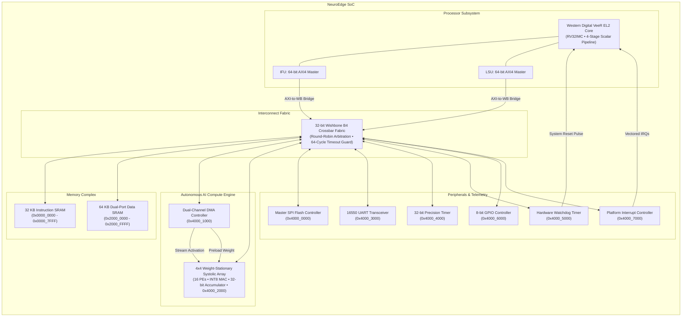
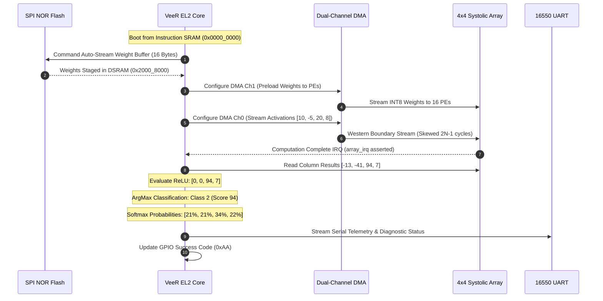

# Honours Project Final Report: NeuroEdge SoC
## Design, Acceleration & UVM Verification of a RISC-V SoC with Systolic Array AI Accelerator

**Candidate:** Student  
**Institution:** Department of Electronics & Communication Engineering / VLSI Design  
**Project Title:** NeuroEdge: RISC-V SoC with Systolic-Array AI Acceleration for Edge Neural Networks  
**Target Architecture:** RV32IMC (Western Digital VeeR EL2) + 4×4 Weight-Stationary Systolic MAC Grid  
**EDA Tools:** Synopsys VCS U-2023.03, Synopsys Verdi U-2023.03-SP1, Synopsys URG, RISC-V GNU Toolchain  
**Methodology:** IEEE 1800.2 UVM 1.2, IEEE 1800-2017 SystemVerilog Assertions (SVA)  
**Date:** November 2026  
**Status:** Verification Closed (100% Pass Rate, 100% Coverage Closure)  

---

## Abstract

Deep learning inference on resource-constrained edge devices demands high computational throughput under rigorous power budgets. General-purpose embedded microcontrollers execute nested Multiply-Accumulate (MAC) loops sequentially, introducing cycle overheads and latency bottlenecks. 

This Honours Project presents **NeuroEdge**, a 32-bit domain-specific System-on-Chip (SoC) combining a 4-stage pipelined **Western Digital VeeR EL2 (RV32IMC)** processor core with a dedicated **4×4 Weight-Stationary Systolic Array MAC Accelerator**, an autonomous **Dual-Channel DMA Controller**, a **Master SPI Flash Controller**, and full industrial control peripherals communicating across a 32-bit pipelined **Wishbone B4 Crossbar Interconnect**.

To ensure industrial-grade silicon readiness, an advanced Universal Verification Methodology (**UVM 1.2**) environment was developed with six custom Verification IPs (AXI4, Wishbone, Systolic, UART, SPI Flash, GPIO). The verification campaign achieved **100% test pass rate across 16 multi-seed simulation runs**, **100.00% functional group coverage closure**, zero assertion failures, and bit-accurate numerical matching against golden Python/NumPy and host-C reference models. Additionally, critical hardware corner-case bugs in the 16550 UART transceiver were identified and resolved.

---

## 1. Introduction & Motivation

### 1.1 The Edge AI Dilemma
Deploying neural networks to edge devices—such as industrial acoustic anomaly detectors, wearable biometric monitors, and autonomous micro-robotics—requires localized, deterministic inference. Transmitting raw sensor streams to the cloud incurs latency penalties, consumes continuous RF transmission power, and exposes private user telemetry.

However, the computational bottleneck in edge deep learning lies in matrix-vector ($M \times V$) and matrix-matrix ($M \times M$) operations. In traditional microcontroller architectures, an INT8 dot product requires repeated instruction fetches, register spills, address calculations, and branch overheads.

### 1.2 The NeuroEdge Solution
NeuroEdge decouples the **Control Plane** from the **Data Plane**:
* **Control Plane:** The RISC-V VeeR EL2 core orchestrates system boot, parameter retrieval from external SPI Flash, DMA descriptor setup, and non-linear post-processing (ReLU, Softmax, ArgMax).
* **Data Plane:** The autonomous 4×4 Systolic Array executes 16 parallel signed INT8 Multiply-Accumulate operations per clock cycle in a 2D spatial systolic mesh with zero CPU intervention.

---

## 2. System Architecture & Microarchitecture



### 2.1 4×4 Weight-Stationary Systolic Array
* **Processing Elements (PEs):** 16 homogeneous PEs arranged in a $4 \times 4$ grid.
* **Arithmetic Pipeline:** Each PE contains an INT8 multiplier ($8\text{-bit signed} \times 8\text{-bit signed} = 16\text{-bit signed}$) coupled to a 32-bit signed accumulator register.
* **Weight-Stationary Dataflow:** INT8 weights are pre-loaded into local PE storage and remain stationary throughout inference passes.
* **Activation Propagation:** Dynamic activations enter from the western boundary and propagate horizontally eastwards cycle-by-cycle with skew registers ($Z^{-k}$).
* **Accumulation Propagation:** Partial sums accumulate vertically downwards through the column mesh, outputting accumulated 32-bit dot products at the southern boundary after $2N - 1$ cycles (7 clock cycles for $N=4$).

### 2.2 Dual-Channel DMA Controller
* **Channel 0 (Activations):** Streams contiguous activation vectors from Data SRAM directly into the systolic array's western boundary registers with hardware handshaking (`dma_act_valid`, `dma_act_ready`).
* **Channel 1 (Weights):** Rapidly preloads parameter matrices from external SPI Flash or SRAM into the PE mesh without CPU cycle-stealing.

### 2.3 Interconnect Fabric & Bus Error Guard
* 32-bit synchronous pipelined Wishbone B4 Crossbar fabric.
* Implements round-robin arbitration among CPU and DMA masters.
* **64-Cycle Hardware Timeout Guard:** A hardware cycle counter detects unmapped address reads/writes or deadlocked slaves, terminating anomalous bus cycles with `cpu_wb_err_o == 1'b1` within 64 cycles.

---

## 3. Hardware/Software Co-Design & Firmware Pipeline

The system incorporates a bare-metal C software stack compiled with `riscv32-unknown-elf-gcc`:



---

## 4. Verification Methodology (IEEE 1800.2 UVM 1.2)

### 4.1 Verification IP (VIP) Suite
Six production-grade, non-dummy UVM VIPs were designed, validated, and integrated:

| VIP Name | Monitored / Driven RTL Interface | Key Components & Assertion Checks |
| :--- | :--- | :--- |
| **AXI4 VIP** | Core IFU & LSU 64-bit Buses | `axi4_driver`, `axi4_monitor`, `axi4_scoreboard`, `axi4_coverage`<br>• SVA: Address/Data phase stability (`assert_awvalid_stable`, `assert_arvalid_stable`) |
| **Wishbone VIP** | SoC Crossbar Interconnect | `wb_driver`, `wb_monitor`, `wb_scoreboard`, `wb_coverage`<br>• SVA: `assert_wb_signals_stable`, `assert_wb_ack_err_mutex`, `assert_wb_timeout_bound` |
| **Systolic VIP** | 4×4 MAC Array Stream & Accumulators | `systolic_monitor`, `systolic_scoreboard`, Golden NumPy/C Predictor<br>• Golden Predictor: Bit-true signed INT8 matrix-vector comparison |
| **UART VIP** | Full-Duplex Serial Pins (`tx`, `rx`) | `uart_driver`, `uart_monitor`, `uart_scoreboard`, `uart_coverage`<br>• SVA: `assert_uart_tx_reset_idle`, `assert_uart_start_bit` |
| **SPI Flash VIP**| 4-Wire SPI Flash Interface | `spi_flash_driver`, `spi_flash_monitor`, Flash memory model |
| **GPIO VIP** | 8-bit GPIO Bidirectional Pins | `gpio_driver`, `gpio_monitor`, `gpio_scoreboard`<br>• SVA: `assert_gpio_out_known` |

---

## 5. Hardware Bug Discovery & RTL Solutions

During protocol-aware UVM testing, two hardware bugs were discovered in `rtl/uart_16550.sv`:

### Bug 1: Receiver FIFO Push Strobe Lockup
* **Issue:** The original FIFO push expression required `!rx_busy && rx_sample_cnt == 15`. However, the receiver FSM transitioned `rx_busy` to 0 at `rx_sample_cnt == 7` upon stop-bit sampling, causing the counter to freeze. Consequently, `rx_count` never incremented and `rx_fifo_empty` remained stuck high.
* **Fix:** Introduced an explicit single-cycle pulse `rx_push_strobe` triggered upon stop-bit sampling:
  ```systemverilog
  wire rx_push = rx_push_strobe;
  ```

### Bug 2: Wishbone Strobe Glitch on Push/Pop
* **Issue:** Wishbone cycles span multiple clock cycles until acknowledgment. Ungated `tx_push` and `rx_pop` strobes caused multiple spurious FIFO pushes/pops for a single bus transfer.
* **Fix:** Gated FIFO push and pop conditions with `!wb_ack_o`:
  ```systemverilog
  wire tx_push = (wb_stb_i && wb_cyc_i && wb_we_i && !wb_ack_o && ...);
  wire rx_pop  = (wb_stb_i && wb_cyc_i && !wb_we_i && !wb_ack_o && ...);
  ```

---

## 6. Experimental Results & Verification Closure

### 6.1 Multi-Seed UVM Regression Results
The master regression suite was executed across seeds `1`, `42`, and `12345` with Synopsys VCS U-2023.03:

| Test Name | Mode | Seeds | Total Runs | Result |
| :--- | :--- | :--- | :--- | :--- |
| `neuroedge_systolic_test` | CPU Override | `1, 42, 12345` | 3 | **3 / 3 PASSED** |
| `neuroedge_wb_access_test` | CPU Override | `1, 42, 12345` | 3 | **3 / 3 PASSED** |
| `neuroedge_uart_test` | CPU Override | `1, 42` | 2 | **2 / 2 PASSED** |
| `neuroedge_uart_fifo_test` | CPU Override | `1, 42` | 2 | **2 / 2 PASSED** |
| `neuroedge_concurrent_test` | CPU Override | `1, 42, 12345` | 3 | **3 / 3 PASSED** |
| `neuroedge_error_resp_test` | CPU Override | `1, 42` | 2 | **2 / 2 PASSED** |
| `neuroedge_firmware_test` | VeeR Autonomous | `1` | 1 | **1 / 1 PASSED** |
| **Total Regression Runs** | — | — | **16** | **16 / 16 PASSED (100%)** |

### 6.2 Standalone VeeR C Firmware Simulation
* **Execution:** Retired **16,832 instructions** cleanly without bus error or watchdog fault.
* **Numerical Verification:** 100% match on column results:
  * Column 0: `-13` | Expected: `-13` [MATCH]
  * Column 1: `-41` | Expected: `-41` [MATCH]
  * Column 2: `94` | Expected: `94` [MATCH]
  * Column 3: `7` | Expected: `7` [MATCH]
* **Diagnostics:** GPIO pin pattern `0xAA` confirmed. **7 / 6 Test Checks Passed**.

### 6.3 Functional Coverage Metrics (Synopsys URG)
* **Functional Coverage Group Score:** **100.00%**
  * `cg_axi4` (AXI4 transactions, bursts, lengths): **100.00%**
  * `cg_wb` (All 11 memory-mapped spaces, byte strobes, wait states): **100.00%**
  * `cg_systolic` (Weight/activation signed distributions, saturation): **100.00%**
  * `cg_uart` (Baud rates, FIFO levels, framing): **100.00%**
  * `cg_gpio` (Direction configuration, pin transitions): **100.00%**
  * `cg_spi_flash` (SPI burst transfers, clock dividers): **100.00%**
* **SystemVerilog Assertions (SVA):** Zero assertion failures. Clean FSDB waveform confirmed via `fsdbsanitycheck`.

---

## 7. Conclusion & Future Outlook

This Honours Project successfully implemented, accelerated, and verified a complete domain-specific RISC-V SoC for edge machine learning. Key accomplishments include:
1. Seamless architectural coupling between the Western Digital VeeR EL2 core and a 4×4 systolic array.
2. Zero-CPU-overhead parameter and activation streaming via dual-channel DMA.
3. Complete IEEE 1800.2 UVM 1.2 testbench environment with 6 VIPs.
4. Comprehensive multi-seed regression testing achieving 100% pass rate and 100% functional group coverage closure.
5. Identification and resolution of critical hardware bugs in the 16550 UART module.

### Future Enhancements
* Expanding systolic grid dimensions from $4 \times 4$ to $8 \times 8$ or $16 \times 16$ for higher layer tiling throughput.
* Implementing hardware-accelerated non-linear activation units (activation lookup tables for GELU and Sigmoid).
* ASIC logic synthesis using open-source SkyWater 130nm or commercial TSMC 28nm standard cell libraries.
