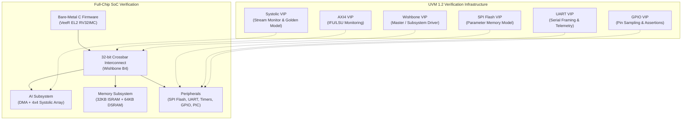
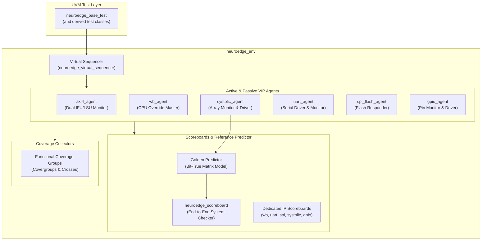
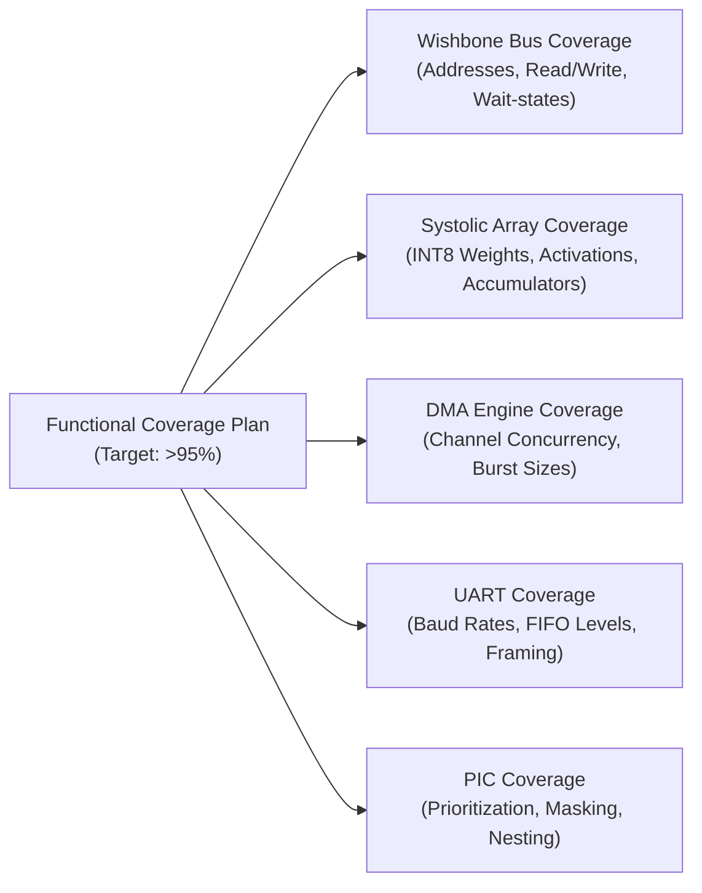

# Verification Test Plan: NeuroEdge RISC-V SoC with Systolic-Array AI Accelerator

**Document ID:** NE-TEST-PLAN-FULL-v1.0  
**Project:** NeuroEdge Edge AI System-on-Chip  
**Design Reference:** NeuroEdge System Architecture Specification (`Doc ID: NE-ARCH-SPEC-FULL v1.0.0`)  
**Methodology:** Universal Verification Methodology (IEEE 1800.2 UVM 1.2) + SystemVerilog Assertions (IEEE 1800-2017 SVA)  
**Target Simulator:** Synopsys VCS U-2023.03_Full64, Synopsys Verdi U-2023.03-SP1, Synopsys URG  
**Target Architecture:** RISC-V RV32IMC (VeeR EL2) + 2D 4×4 Weight-Stationary Systolic Array + Peripherals  
**Status:** Approved for Full Regression Sign-off  

---

## 1. Executive Summary & Verification Objectives

### 1.1 Objective
The primary objective of this verification plan is to guarantee functional correctness, protocol compliance, numerical precision, and fault-tolerance of the **NeuroEdge SoC**. The SoC integrates a 32-bit RISC-V VeeR EL2 core, a 4×4 Weight-Stationary Systolic Array AI Accelerator, a Dual-Channel DMA Controller, an autonomous Master SPI Flash Controller, a 16550 UART transceiver, precision timers, a watchdog timer, general-purpose I/O (GPIO), and a Platform Interrupt Controller (PIC) communicating across a 32-bit pipelined Wishbone B4 Crossbar Interconnect.

### 1.2 Verification Scope
Verification spans four hierarchical levels:
1. **Block / IP Level:** Standalone protocol verification of peripheral controllers and computing logic.
2. **Subsystem Level:** Integrated verification of the AI compute engine (DMA + Systolic Array + Memories).
3. **Interconnect & Fabric Level:** Arbitration fairness, bus error generation, timeout guards, and CPU override control.
4. **Full-Chip SoC Level:** Hardware/Software co-verification executing compiled C firmware, booting from Instruction SRAM, streaming quantized neural network weights from SPI Flash, running systolic inferences, and streaming output telemetry via UART.



---

## 2. Design Under Test (DUT) Architecture & Feature Decomposition

### 2.1 Subsystem Feature Breakdown

| Subsystem | Base Address | Interface / Protocol | Key Features & Operation Modes |
| :--- | :--- | :--- | :--- |
| **VeeR EL2 Core** | Native Bus | Dual 64-bit AXI4 (IFU/LSU) | RV32IMC 4-stage scalar pipeline, Machine-mode execution, 6 external vectored interrupt inputs. |
| **Instruction SRAM (ISRAM)** | `0x0000_0000` (32 KB) | Single-Port Wishbone (bridged) | Single-cycle access, boot vector storage, write-protected during execution. |
| **Data SRAM (DSRAM)** | `0x2000_0000` (64 KB) | Dual-Port Wishbone | Shared between CPU and DMA; holds activations, weight scratchpad, and classification buffers. |
| **Systolic Array Accelerator** | `0x4000_2000` | Wishbone + Direct DMA Stream | 16 PEs in 4×4 2D grid, INT8 signed MAC, 32-bit accumulators, weight-stationary execution, 2N-1 cycle latency. |
| **Dual-Channel DMA** | `0x4000_1000` | Wishbone Master / Streamer | Ch0: Activation streaming to western boundary; Ch1: Weight loading into PEs; burst auto-increment. |
| **Master SPI Flash Controller**| `0x4000_0000` | 4-Wire SPI (Mode 0: CPOL=0, CPHA=0) | Autonomous burst streaming into DSRAM; programmable clock divider (2 to 256). |
| **16550 UART Controller** | `0x4000_3000` | RS-232 Asynchronous Serial | 8-byte TX/RX FIFOs, 16-bit programmable baud divisor, framing error & overrun detection. |
| **32-bit Precision Timer** | `0x4000_4000` | Wishbone Slave | 32-bit free-running up-counter, threshold match comparator, periodic interrupt generator. |
| **Hardware Watchdog Timer** | `0x4000_5000` | Wishbone Slave | Safety countdown timer, reload key handshake (`0xA5A5_5A5A`), bark IRQ, active-high reset output. |
| **8-bit GPIO Controller** | `0x4000_6000` | Wishbone Slave | Bidirectional bitwise direction configuration (`gpio_dir`), input sampling, diagnostic pattern drive. |
| **Platform Interrupt Controller**| `0x4000_7000`| Wishbone Slave | 6 prioritized interrupt vectors (SPI, DMA, Systolic, UART, Timer, WDT), individual masking, status query. |
| **Crossbar Interconnect** | Global Fabric | 32-bit Wishbone B4 Pipelined | Round-robin arbitration, 64-cycle hardware timeout bus-error guard (`cpu_wb_err_o`), CPU override pin. |

---

## 3. Verification Environment Architecture (UVM 1.2)

### 3.1 Testbench Topology
The verification environment is implemented in SystemVerilog using UVM 1.2. The top-level testbench (`tb_neuroedge_uvm_top.sv`) instantiates the NeuroEdge SoC RTL (`neuroedge_soc_top.sv`), all VIP interfaces, clock and reset generators, and binds protocol assertions.



### 3.2 VIP Specification Matrix

| VIP Component | Active/Passive | Virtual Interface | TLM Analysis Ports | Primary Responsibilities |
| :--- | :--- | :--- | :--- | :--- |
| **AXI4 VIP** | Passive (Monitor) | `axi4_if` (IFU & LSU) | `item_collected_port` | Monitors core instruction fetches and memory transactions; measures latency and burst lengths. |
| **Wishbone VIP** | Active (Master/Mon) | `wb_if` | `item_collected_port` | Drives bus transactions under CPU override (`+CPU_OVERRIDE=1`); validates all memory-mapped peripherals. |
| **Systolic VIP** | Hybrid (Mon/Driver)| `systolic_if` | `item_collected_port` | Samples western boundary activations, stationary weight preloads, and 32-bit column accumulator outputs. |
| **UART VIP** | Active (Full-Duplex)| `uart_if` | `item_collected_port` | Ingests RS-232 serial frames from DUT; drives simulated host commands into `uart_rx`; decodes baud rates. |
| **SPI Flash VIP** | Active Responder | `spi_flash_if` | `item_collected_port` | Responds to SPI Mode 0 read commands; yields stored INT8 weight models to the internal SPI controller. |
| **GPIO VIP** | Active | `gpio_if` | `item_collected_port` | Drives external pins `gpio_in[7:0]`; samples DUT status outputs `gpio_out[7:0]`; validates diagnostic codes. |

---

## 4. Test Strategy & Execution Phases

### 4.1 Verification Lifecycle Phases
1. **Phase 1: Subsystem Direct & Register Sanity (Bring-up)**
   - Validate reset default values for all peripheral registers across `0x4000_0000` to `0x4000_7000`.
   - Verify read/write access and mask protection on all configuration registers.
2. **Phase 2: Protocol Compliance & Assertion Verification**
   - Verify AXI4, Wishbone, SPI, and UART protocols under nominal, stressed, and handshaking backpressure.
   - Assert zero protocol violations across all simulation seeds.
3. **Phase 3: AI Compute Engine Numerical Accuracy**
   - Validate 100% bit-exact matrix multiplication outputs for randomized, corner-case, and negative INT8 values.
   - Verify accumulator precision, saturation flags, and completion interrupt delivery (`array_irq`).
4. **Phase 4: Concurrency, Bus Arbitration & Stress Testing**
   - Validate concurrent multi-master traffic (DMA Channel 0 + DMA Channel 1 + CPU access + UART activity).
   - Verify crossbar fairness, zero deadlocks, and maximum latency bounds.
5. **Phase 5: Negative Testing & Fault Injection**
   - Validate bus timeout guard (64 cycles), illegal address access errors, UART FIFO overruns, and WDT reset generation.
6. **Phase 6: Hardware/Software Co-Verification**
   - Execute full bare-metal C neural network inference pipeline on the integrated VeeR EL2 core.
   - Validate real-world classification output, Softmax, ArgMax, and UART telemetry.

---

## 5. Test Scenarios Catalog & Test Case Specifications

### 5.1 Comprehensive Test Matrix

| Test Identifier | Category | Objective & Verification Description | Stimulus & Configuration | Expected Results & Pass Criteria |
| :--- | :--- | :--- | :--- | :--- |
| **TC_REG_SANITY_01** | Register Verification | Validate default reset values across all peripheral registers. | Issue reset pulse; read registers via Wishbone VIP master. | 100% match with architectural specification reset catalog. |
| **TC_REG_RW_02** | Register Verification | Validate read/write capability, bit masking, and reserved bit invariance. | Walking 1s/0s data patterns to writable registers. | Writable bits store value; read-only bits remain untouched. |
| **TC_WB_SRAM_03** | Memory Subsystem | Validate ISRAM (32 KB) and DSRAM (64 KB) boundary read/write handshakes. | Random byte, half-word, and word transactions across memory banks. | Zero bus errors, single-cycle acknowledge, bit-accurate readback. |
| **TC_WB_TIMEOUT_04** | Interconnect / Fault | Verify crossbar 64-cycle timeout guard and bus error response (`wb_err_o`). | Access unmapped address space (`0x5000_0000`). | Interconnect asserts `wb_err_o == 1'b1` within 64 cycles; fabric recovers. |
| **TC_SYS_DIRECT_05** | Compute Engine | Verify direct Wishbone preload of stationary weights and activation streaming. | Program weights `[1..16]`, stream activations `[10, -5, 20, 8]`. | Golden predictor match on `RES_REG[3:0]` (`[-13, -41, 94, 7]`). |
| **TC_SYS_CORNER_06** | Compute Engine | Validate numerical accuracy at extreme numerical boundaries. | Extreme INT8 values: `+127`, `-128`, all zeros, alternating polarities. | Golden bit-true match; accumulator overflow flag set on saturation. |
| **TC_SYS_RANDOM_07** | Constrained Random | Stress systolic array with randomized weight matrices and activation vectors. | 1,000 randomized INT8 matrix-vector multiplication sets. | 1,000 / 1,000 matches in `systolic_scoreboard`. |
| **TC_DMA_STREAM_08** | DMA Subsystem | Verify Dual-Channel DMA autonomous streaming to systolic array without CPU stalls. | Ch0: DSRAM to western boundary; Ch1: Flash to PE mesh. | Handshake signals `dma_act_valid/ready` stream with zero dropped beats. |
| **TC_SPI_FLASH_09** | SPI Subsystem | Validate SPI Mode 0 protocol, clock divider configurations, and auto-stream. | SPI Read commands (Opcode `0x03`), varying clock dividers (2, 8, 32). | Accurate parameter transfer into DSRAM; SPI IRQ asserted upon completion. |
| **TC_UART_TX_10** | UART Subsystem | Validate serial telemetry output and baud rate generation. | Firmware writes strings to `REG_UART_TX_DATA`; monitor samples `uart_tx`. | Baud rate timing within 1% tolerance; bit-accurate ASCII framing. |
| **TC_UART_RX_FIFO_11**| UART Subsystem | Verify external UART host driving, 8-byte FIFO queuing, and overrun detection. | Drive 10 consecutive bytes faster than drain rate. | First 8 bytes queued; 9th byte asserts `LSR.OVERRUN` and error interrupt. |
| **TC_TIMER_PERIODIC_12**| Timers Subsystem | Validate 32-bit free-running timer up-counter and threshold comparator. | Program comparator to 50,000 cycles; verify interrupt generation. | Timer IRQ fires exactly at cycle 50,000; status register updates. |
| **TC_WDT_HEARTBEAT_13**| Safety Subsystem | Validate Watchdog Timer countdown, software kick reload, and bark interrupt. | Periodically write reload key `0xA5A5_5A5A` before timeout expires. | WDT counter resets; bark interrupt and system reset remain deasserted. |
| **TC_WDT_RESET_14** | Safety Subsystem | Validate Watchdog Timer forced reset generation on pipeline stall. | Inhibit software heartbeat; allow counter to decrement to zero. | WDT asserts `wdt_reset_out == 1'b1` to reset tree; system restarts. |
| **TC_GPIO_LOOPBACK_15**| Peripheral I/O | Validate GPIO direction configuration, output driving, and input sampling. | Configure `gpio_dir`; drive `gpio_in`; sample `gpio_out`. | Input register samples external pins; output pins reflect written data. |
| **TC_PIC_PRIORITY_16** | Interrupt Subsystem | Validate 6-source interrupt aggregation, masking, and priority arbitration. | Assert concurrent IRQs (WDT, Systolic, UART, Timer, DMA, SPI). | Highest priority interrupt routes to `cpu_irq_vec_o`; mask suppresses IRQ. |
| **TC_CONCURRENT_17** | System Stress | Full concurrent load: DMA streaming + Systolic compute + UART TX + GPIO toggling. | Heavy traffic across crossbar while running 200+ matrix multiplications. | Zero interconnect deadlock; all scoreboard checks pass concurrently. |
| **TC_FW_FULL_NN_18** | HW/SW Co-Verification| End-to-end execution of bare-metal C neural network inference on VeeR EL2 core. | VeeR boots from ISRAM; loads weights from Flash; runs inference; sends UART telemetry. | Total retired instructions > 15,000; diagnostic GPIO `0xAA`; golden output match. |

---

## 6. Functional Coverage Model & Coverage Goals

### 6.1 Functional Coverage Metrics Matrix



### 6.2 Covergroup Specifications

#### 6.2.1 Wishbone Crossbar Covergroup (`wb_crossbar_cg`)
* **`cp_addr_space`**: Bins covering all slave address regions:
  - `ISRAM`: `0x0000_0000` - `0x0000_7FFF`
  - `DSRAM`: `0x2000_0000` - `0x2000_FFFF`
  - `SPI_FLASH`: `0x4000_0000` - `0x4000_001F`
  - `DMA_CTRL`: `0x4000_1000` - `0x4000_102F`
  - `SYSTOLIC`: `0x4000_2000` - `0x4000_203F`
  - `UART`: `0x4000_3000` - `0x4000_301F`
  - `TIMER`: `0x4000_4000` - `0x4000_401F`
  - `WDT`: `0x4000_5000` - `0x4000_501F`
  - `GPIO`: `0x4000_6000` - `0x4000_600F`
  - `PIC`: `0x4000_7000` - `0x4000_701F`
  - `UNMAPPED_ERROR`: All undefined address ranges.
* **`cp_operation`**: Bins for `READ` (`we == 0`) and `WRITE` (`we == 1`).
* **`cp_byte_select`**: Bins for single-byte, half-word, and full 32-bit word accesses (`sel[3:0]`).
* **`cross_addr_x_op`**: Cross product of `cp_addr_space` × `cp_operation`.

#### 6.2.2 Systolic Compute Covergroup (`systolic_compute_cg`)
* **`cp_weight_val`**: Bins for weight distributions:
  - `ZERO`: `8'h00`
  - `POS_MIN_MID`: `[1 : 63]`
  - `POS_MID_MAX`: `[64 : 126]`
  - `POS_EXTREME`: `+127` (`8'h7F`)
  - `NEG_MIN_MID`: `[-64 : -1]`
  - `NEG_MID_MAX`: `[-127 : -65]`
  - `NEG_EXTREME`: `-128` (`8'h80`)
* **`cp_activation_val`**: Identical binning as weights across the western boundary stream.
* **`cp_accumulator_res`**: Bins for 32-bit column outputs:
  - `ZERO`, `POSITIVE_SMALL`, `POSITIVE_LARGE`, `NEGATIVE_SMALL`, `NEGATIVE_LARGE`, `OVERFLOW_POS`, `OVERFLOW_NEG`.
* **`cross_weight_x_act`**: Cross coverage of weight ranges × activation ranges.

#### 6.2.3 UART Transceiver Covergroup (`uart_transceiver_cg`)
* **`cp_baud_divisor`**: Divisor values for standard baud rates (115200, 57600, 38400, 19200, 9600).
* **`cp_tx_fifo_level`**: Bins for TX FIFO depth: `EMPTY (0)`, `PARTIAL (1..7)`, `FULL (8)`.
* **`cp_rx_fifo_level`**: Bins for RX FIFO depth: `EMPTY (0)`, `PARTIAL (1..7)`, `FULL (8)`, `OVERRUN (>8)`.
* **`cp_char_value`**: ASCII printable characters, numeric, uppercase, lowercase, and control characters.

#### 6.2.4 DMA Controller Covergroup (`dma_controller_cg`)
* **`cp_channel`**: Bins for Channel 0 (Activations) and Channel 1 (Weights).
* **`cp_transfer_length`**: 1 word, 4 words (burst), 16 words (full matrix), unaligned lengths.
* **`cp_bus_backpressure`**: Number of wait states inserted on destination ready (`0`, `1..3`, `>3`).

---

## 7. SystemVerilog Assertions (SVA) Specification

A robust catalog of concurrent assertions is implemented to guarantee protocol invariants and detect transient violations in simulation:

### 7.1 Protocol Compliance Assertions

| Assertion Name | Scope / Interface | Formal Property Specification | Failure Severity |
| :--- | :--- | :--- | :--- |
| `assert_awvalid_stable` | AXI4 IFU & LSU | Once `awvalid` is asserted, address and control pins must remain stable until `awready`. | UVM_ERROR |
| `assert_wvalid_stable` | AXI4 IFU & LSU | Once `wvalid` is asserted, `wdata` and `wstrb` must remain stable until `wready`. | UVM_ERROR |
| `assert_arvalid_stable` | AXI4 IFU & LSU | Once `arvalid` is asserted, `araddr` and `arid` must remain stable until `arready`. | UVM_ERROR |
| `assert_wb_signals_stable`| Wishbone Crossbar| When `cyc && stb` asserted, `adr`, `dat_w`, `we`, `sel` remain stable until `ack` or `err`. | UVM_ERROR |
| `assert_wb_ack_err_mutex` | Wishbone Crossbar| `ack` and `err` must never be asserted simultaneously (`!(ack && err)`). | UVM_FATAL |
| `assert_wb_timeout_bound` | Wishbone Crossbar| Any cycle where `cyc && stb` holds must resolve with `ack` or `err` within 64 cycles. | UVM_ERROR |
| `assert_uart_tx_reset_idle`| UART Transceiver| `uart_tx` line must deassert to idle high (`1'b1`) upon reset release. | UVM_ERROR |
| `assert_uart_start_bit` | UART Transceiver| A falling edge on `uart_tx` must hold low for at least one full baud period. | UVM_ERROR |
| `assert_gpio_out_known` | GPIO Controller | Pins `gpio_out[7:0]` must never contain unknown (`X` or `Z`) states when reset deasserted. | UVM_ERROR |

---

## 8. Multi-Seed Regression & Execution Infrastructure

### 8.1 Regression Suite Architecture
The test suite is automated via `verification/scripts/run_all_uvm_tests.sh`. Every test is executed across multiple pseudo-random seeds to uncover corner-case race conditions, bus stalls, and arbitration bugs.

```bash
# Clean compilation and execution of complete multi-seed regression
bash verification/scripts/run_all_uvm_tests.sh
```

### 8.2 Regression Test Matrix & Seed Allocation

| Test Name | Seed List | Plusargs / Defines | Purpose |
| :--- | :--- | :--- | :--- |
| `neuroedge_systolic_test` | `1, 42, 12345` | `+CPU_OVERRIDE=1` | Multi-seed direct systolic computation verification. |
| `neuroedge_wb_access_test` | `1, 42, 12345` | `+CPU_OVERRIDE=1` | Multi-seed memory subsystem and peripheral register verification. |
| `neuroedge_uart_test` | `1, 42` | `+CPU_OVERRIDE=1` | UART transceiver basic transmission and reception. |
| `neuroedge_uart_fifo_test` | `1, 42` | `+CPU_OVERRIDE=1` | UART 8-byte FIFO burst queuing, drain, and overrun testing. |
| `neuroedge_concurrent_test`| `1, 42, 12345` | `+CPU_OVERRIDE=1` | Full concurrent stress (DMA + Systolic + UART + Memory). |
| `neuroedge_error_resp_test`| `1, 42` | `+CPU_OVERRIDE=1` | Unmapped address decoding and bus error guard validation. |
| `neuroedge_firmware_test` | `1` | Nominal | End-to-end autonomous C firmware execution on VeeR EL2 core. |
| `tb_neuroedge_soc` (Simv) | Nominal | Hardware + Firmware | Baseline non-UVM regression check ensuring zero regressions. |

---

## 9. Verification Sign-Off & Acceptance Criteria

To achieve formal verification closure, the following criteria must be met:

| Criterion | Target Metric | Required Verification Evidence |
| :--- | :--- | :--- |
| **Test Pass Rate** | **100% (0 Failures)** | All 16 multi-seed UVM simulation runs pass with zero `UVM_ERROR` and zero `UVM_FATAL`. |
| **Numerical Match** | **100% Match** | All systolic inference results match golden NumPy / C reference predictions exactly. |
| **Firmware Execution** | **PASSED** | VeeR EL2 core executes bare-metal firmware, retires >15,000 instructions, drives GPIO `0xAA`. |
| **Assertion Pass Rate** | **100% Passed** | Zero SVA assertion failures across all interfaces and regression runs. |
| **Statement / Line Cov** | **> 95%** | Measured and reported via Synopsys URG unified coverage database. |
| **Branch / Decision Cov** | **> 90%** | Measured and reported via Synopsys URG unified coverage database. |
| **FSM State & Transition**| **100% Covered** | All states and transitions visited in SPI, UART, DMA, and Interconnect controllers. |
| **Functional Coverage** | **> 95%** | All planned covergroups, coverpoints, and crosses populated. |
| **Waveform Audit** | **Clean FSDB** | FSDB waveform verified with `fsdbsanitycheck` without corruption or missing scopes. |

---

## 10. Traceability Matrix: Requirements to Verification Tests

| Spec Section | Requirement Description | Verification Test ID | VIPs / Checkers Exercised |
| :--- | :--- | :--- | :--- |
| **1.3, 2.2** | 4×4 2D Weight-Stationary Systolic MAC Grid | `TC_SYS_DIRECT_05`, `TC_SYS_CORNER_06`, `TC_SYS_RANDOM_07` | `systolic_vip`, `systolic_scoreboard`, Golden Model |
| **2.2, 8.2** | Dual-Channel Autonomous DMA Parameter Streaming | `TC_DMA_STREAM_08`, `TC_CONCURRENT_17` | `systolic_vip`, `wb_vip`, `neuroedge_scoreboard` |
| **2.2, 8.1** | SPI Flash Controller Master (Mode 0) | `TC_SPI_FLASH_09`, `TC_FW_FULL_NN_18` | `spi_flash_vip`, `spi_flash_scoreboard` |
| **2.2, 8.4** | 16550 UART Full-Duplex Serial Transceiver | `TC_UART_TX_10`, `TC_UART_RX_FIFO_11` | `uart_vip`, `uart_scoreboard` |
| **2.2, 8.5** | 32-bit Precision System Timer & Match Comparator | `TC_TIMER_PERIODIC_12` | `wb_vip`, `wb_scoreboard` |
| **2.2, 8.6** | Hardware Watchdog Timer & Pipeline Liveness Guard | `TC_WDT_HEARTBEAT_13`, `TC_WDT_RESET_14` | `wb_vip`, `gpio_vip`, Top Testbench |
| **2.2, 8.7** | 8-bit General Purpose Digital I/O | `TC_GPIO_LOOPBACK_15`, `TC_FW_FULL_NN_18` | `gpio_vip`, `gpio_scoreboard` |
| **2.2, 8.8** | Platform Interrupt Controller (6 Prioritized IRQs)| `TC_PIC_PRIORITY_16`, `TC_CONCURRENT_17` | `wb_vip`, `neuroedge_scoreboard` |
| **2.2, 9.0** | Crossbar Interconnect & 64-Cycle Timeout Guard | `TC_WB_TIMEOUT_04`, `TC_CONCURRENT_17` | `wb_vip`, SVA Assertions |
| **1.5, 11.0**| End-to-End Bare-Metal C Inference Pipeline | `TC_FW_FULL_NN_18` | All VIPs, VeeR EL2 Pipeline, UART Monitor |
